# SmartBasket

[](https://github.com/RaedGasmi/SmartBasket/actions/workflows/ci.yml)

A mobile shopping assistant that recommends products and shows a user's shopping habits, backed by a machine-learning recommender served through a REST API.

> **Proof of concept on foreign data.** The long-term goal is a multi-shop shopping assistant for Tunisia. This MVP is **not** trained on Tunisian data: it uses the public [Instacart Market Basket Analysis](https://www.kaggle.com/c/instacart-market-basket-analysis) dataset (US grocery orders). The pipeline reads six CSV files in the Instacart layout, so local data in the same layout can replace it later. Nothing here says how well the models would work on Tunisian shopping behaviour.

## Problem statement

Shoppers repeat most of what they buy, and they also want ideas for what to add to the basket. SmartBasket answers three questions:

- **Frequently bought together:** which products go with this one?
- **Recommended for you:** what will this user probably buy again, and what could they try?
- **Habits:** how often does this user shop, and in which categories?

## Architecture

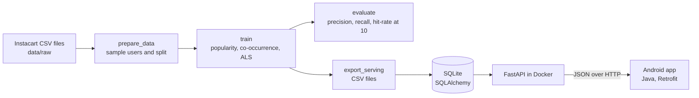

Recommendations are computed offline and stored in the database, so the API only runs read queries. Changing `DATABASE_URL` is the only switch for another database (PostgreSQL has not been tested yet, see [Limitations](#limitations)).

## Model comparison

Three recommenders were compared on the same data: a **popularity** baseline, **item-to-item co-occurrence** (cosine similarity on shared baskets) and **collaborative filtering with implicit ALS**.

**Setup.** 20,000 users sampled with a fixed seed (42) among those whose last order is labelled. Each user's earlier orders are the training history and their last order is the holdout. Metrics are averaged over users at k = 10.

Two protocols are reported, because grocery shopping is repeat-driven (59.7% of the items in the holdout orders were already in the user's history):

- **full:** a model may recommend items the user bought before, and every holdout item counts.
- **discovery:** the user's history is excluded and only items the user never bought before count. Users with nothing new in their last order are skipped (16,295 of 20,000 remain).

### Protocol `full` (20,000 users)

| Model | precision@10 | recall@10 | hit-rate@10 |
|---|---|---|---|
| Popularity | 0.0716 | 0.0684 | 0.4521 |
| **Co-occurrence** | **0.2528** | **0.3059** | **0.8395** |
| ALS | 0.1182 | 0.1458 | 0.6317 |

### Protocol `discovery` (16,295 users)

| Model | precision@10 | recall@10 | hit-rate@10 |
|---|---|---|---|
| Popularity | 0.0199 | 0.0382 | 0.1674 |
| Co-occurrence | 0.0213 | 0.0440 | 0.1746 |
| **ALS** | **0.0250** | **0.0546** | **0.2041** |

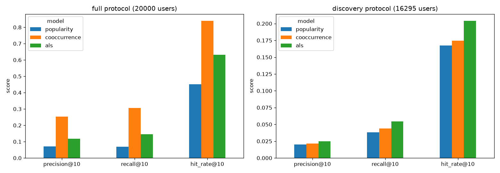

How to read this:

- In `full`, co-occurrence is clearly best. A likely reason is that repeat purchases dominate and its scoring also votes for the items a user already buys; this was not tested separately.
- In `discovery`, ALS is best, but the margins are small and the absolute precision is low (at most 0.025). Finding new products is a hard task on this data.
- Each number comes from a single run with one seed and one split, so there are no confidence intervals. Small differences, such as co-occurrence against popularity in `discovery`, should not be over-interpreted.

The raw metrics are in `ml/results/metrics.json` and `ml/results/results_table.md`.

### Cold start

A user without history gets the popularity list. The API marks this with `"strategy": "popularity_fallback"`, and the app shows a note explaining why (see the screenshots).

## API

Interactive documentation (Swagger UI) is generated at `http://127.0.0.1:8000/docs`.

| Endpoint | Description |
|---|---|
| `GET /products?q=&limit=&offset=` | Search products by name, paginated |
| `GET /products/{product_id}` | One product (404 if unknown) |
| `GET /products/{product_id}/bought-together?limit=` | Products frequently bought with it, with a similarity score |
| `GET /users/{user_id}/recommendations?strategy=&limit=` | `strategy` is `reorder` (default) or `discovery`; unknown users get the popularity list |
| `GET /habits/{user_id}` | Number of orders, average days between orders, top categories (404 if unknown) |

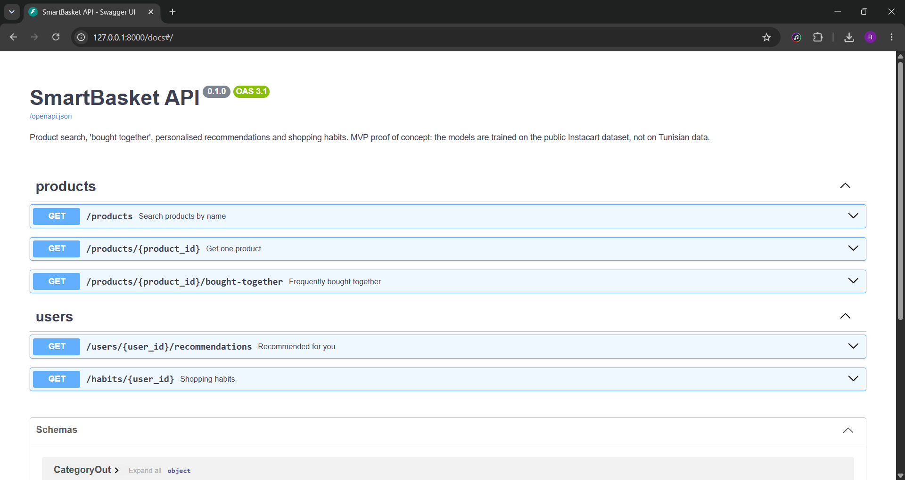

## Android app

Java with XML layouts, Retrofit and RecyclerView. Three screens: product list with search, product detail with "Bought together", and "For you" with a habits summary. Loading, empty and error states are handled. The MVP has no login, so "For you" always shows one demo user of the sample.

| Search | No results | Product detail |
|---|---|---|
| 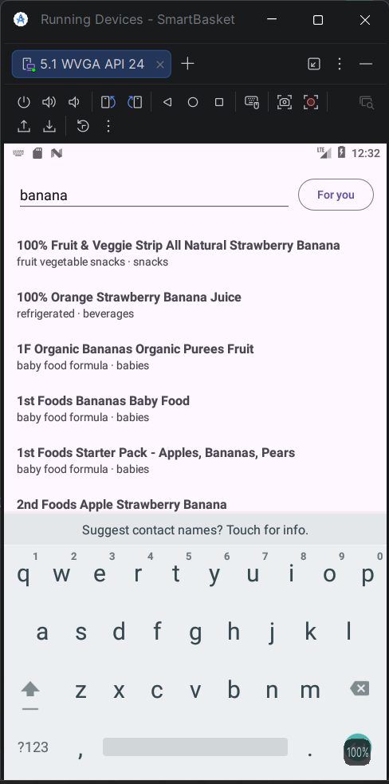 | 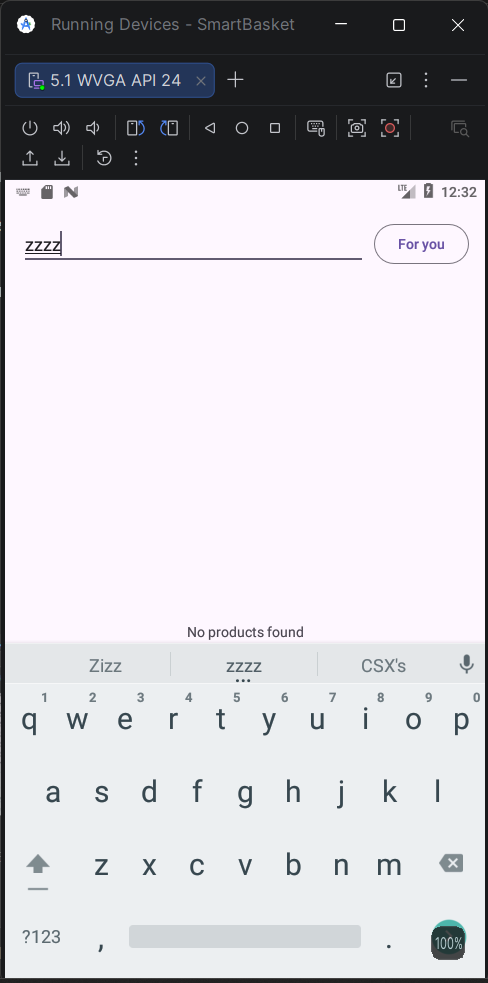 | 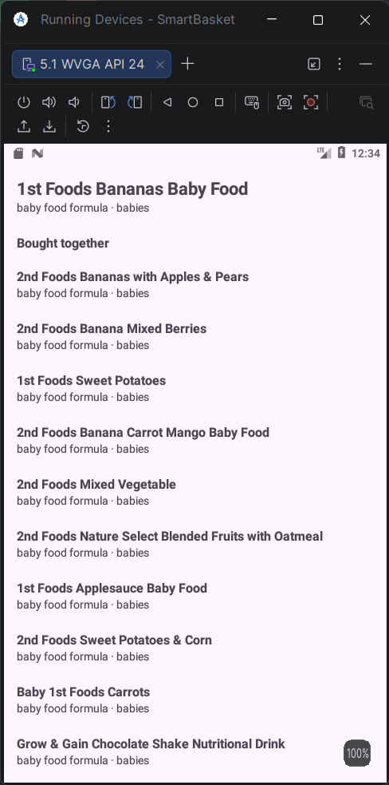 |

| For you: buy again | For you: discover | Cold start |
|---|---|---|
| 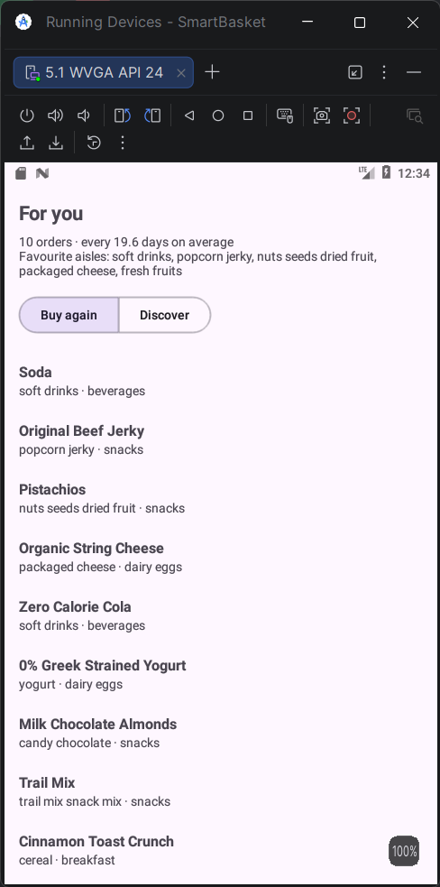 | 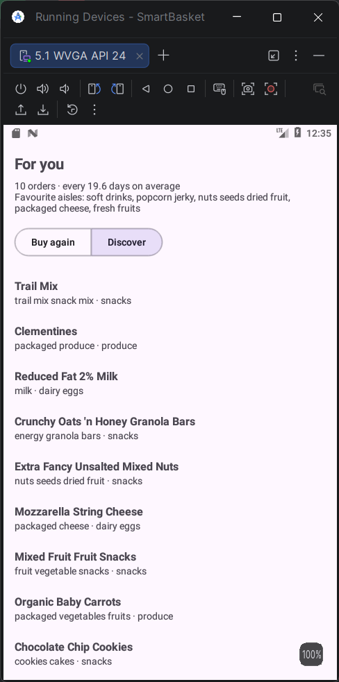 | 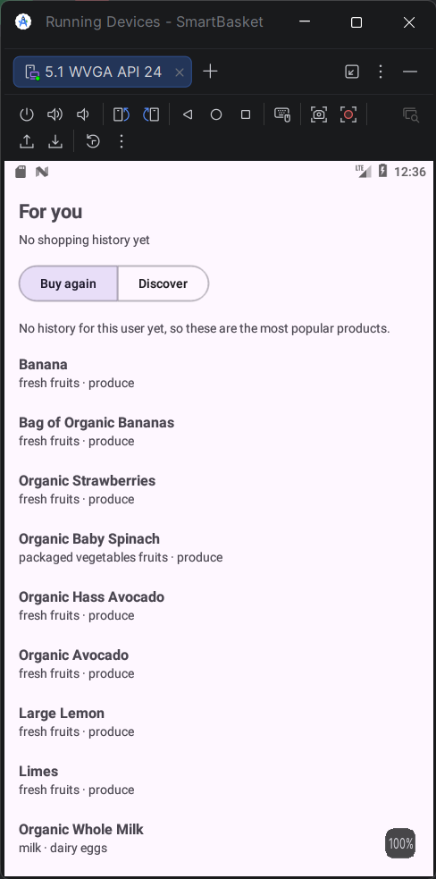 |

| Server unreachable |
|---|
| 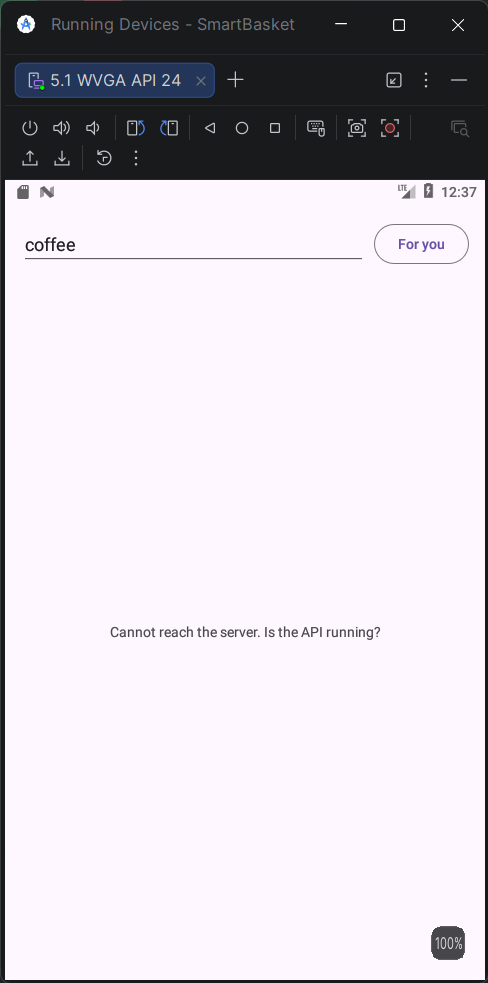 |

## How to run

Requirements: Python 3.12, Docker, and Android Studio for the app.

### 1. Get the data

Download the Instacart dataset from Kaggle (login required) and put these files in `data/raw/`: `orders.csv`, `order_products__prior.csv`, `order_products__train.csv`, `products.csv`, `aisles.csv`, `departments.csv`. The dataset and the generated database are not committed, and the dataset is subject to Instacart's own terms.

### 2. Train, evaluate and build the database

```bash
python -m venv .venv
# Windows PowerShell: .\.venv\Scripts\Activate.ps1   |   Linux/macOS: source .venv/bin/activate
pip install -r ml/requirements.txt -r backend/requirements-dev.txt

python -m ml.src.prepare_data
python -m ml.src.eda
python -m ml.src.train
# TODO(raed): confirm the exact commands for the three steps below
python -m ml.src.report
python -m ml.src.export_serving
python -m backend.scripts.load_db
```

Training is reproducible: the seed is fixed and `train` writes `ml/results/metrics.json`.

### 3. Start the API

```bash
docker compose up --build -d
```

The API listens on `http://127.0.0.1:8000`, and the compose file mounts `./data` so the container reads `data/smartbasket.db`. The image is 240 MB.

### 4. Run the tests

```bash
python -m pytest -q
```

There are 50 tests. GitHub Actions runs the backend and ML tests as two parallel jobs.

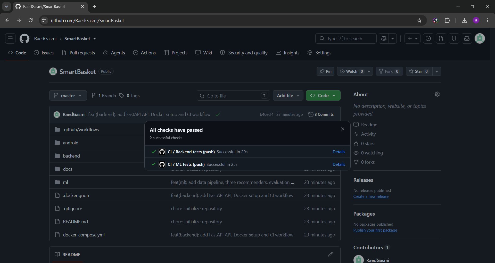

### 5. Run the Android app

Open the `android/` folder in Android Studio, let Gradle sync, and run on an emulator (API 24 or newer). The emulator reaches the API on the host through `http://10.0.2.2:8000`, and the app allows plain HTTP only for this local setup. Start the API first.

## Tech stack

- **ML:** Python 3.12, pandas, SciPy, scikit-learn, `implicit` (ALS), matplotlib
- **Backend:** FastAPI, SQLAlchemy with SQLite, Pydantic, pytest
- **DevOps:** Docker, Docker Compose, GitHub Actions
- **Mobile:** Java, XML layouts, Retrofit, RecyclerView, Material components

Exact versions are pinned in `ml/requirements.txt`, `backend/requirements.txt` and `android/gradle/libs.versions.toml`.

## Limitations

- **Foreign dataset.** All results come from Instacart, a US grocery dataset. They say nothing yet about Tunisian shops, products or habits.
- **Cold start.** Unknown users only get popular products. Very rarely bought products have no "bought together" list. Item cold start was small in this sample (0.3% of holdout items were never seen in training), but a new local catalogue would have much more of it.
- **Evaluation.** One run, one seed, one split, and a sample of 20,000 users. No confidence intervals.
- **Offline recommendations.** Lists are precomputed for the sampled users, so new orders do not change them until the pipeline is run again.
- **App.** The product list shows the first 50 results with no paging, and the demo user is fixed because there is no authentication.
- **Database.** PostgreSQL through `DATABASE_URL` has not been tested, only SQLite.
- **Tests.** Starlette prints a deprecation warning about `httpx` in the test run. It does not affect the API.

## Roadmap

Out of scope for this MVP:

- Price comparison across Tunisian shops
- Scraping shop websites
- Cross-shop product matching
- Price alerts
- Authentication and real user accounts

Next technical steps: collect local data in the Instacart layout, test PostgreSQL, add paging to the app and repeat the evaluation with several seeds.
